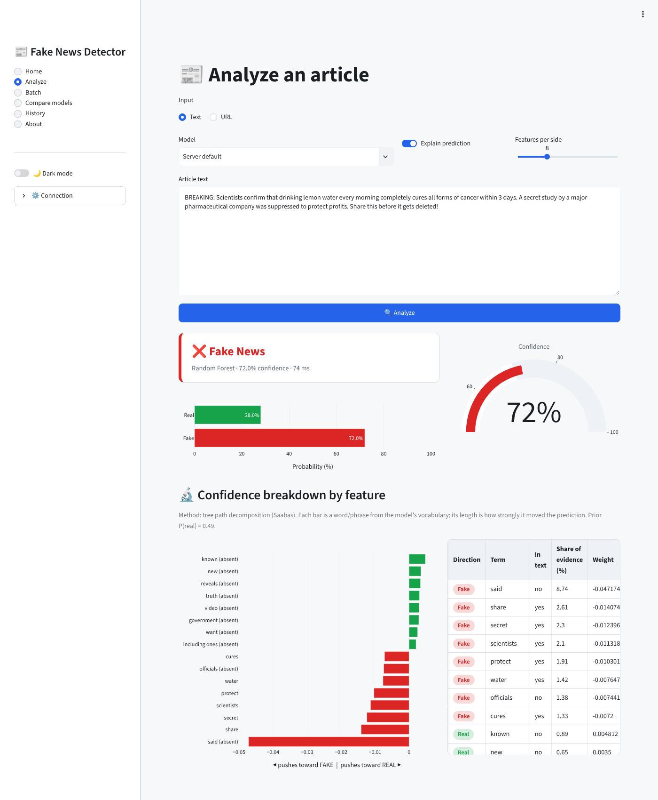
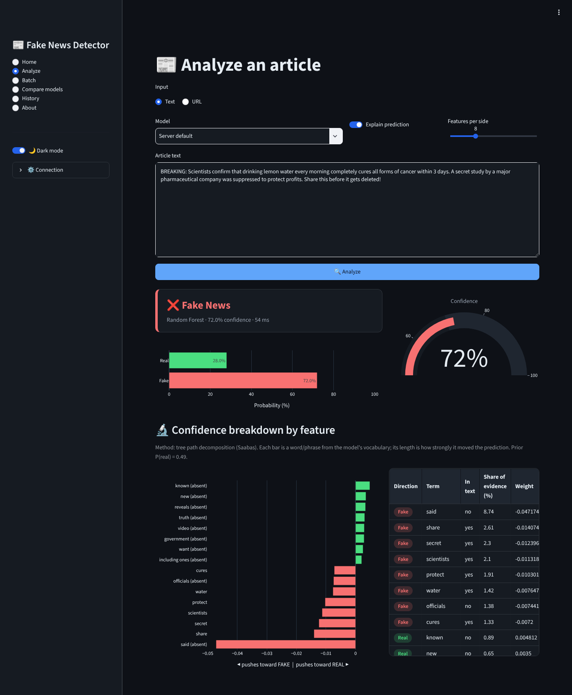
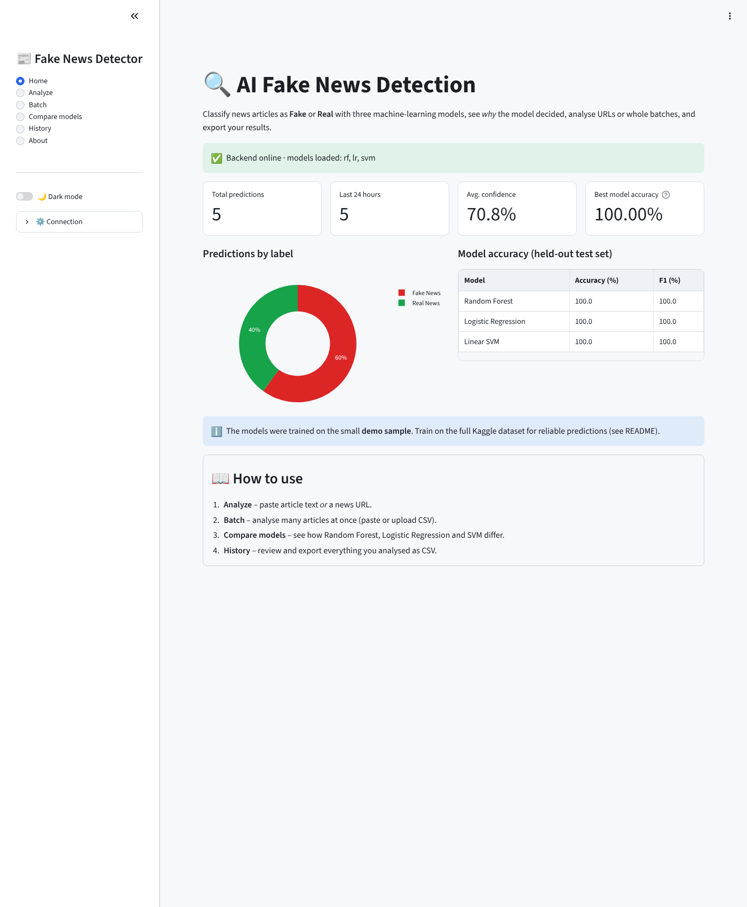
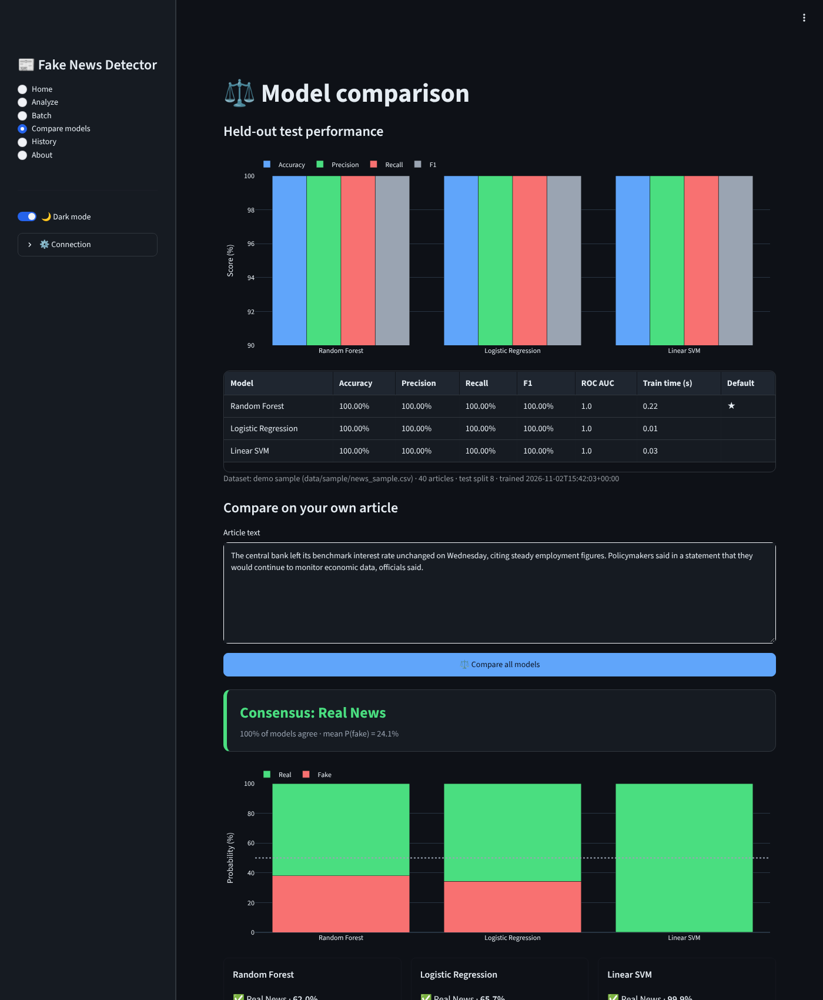
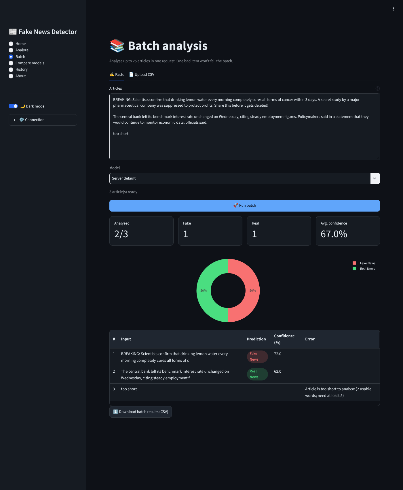
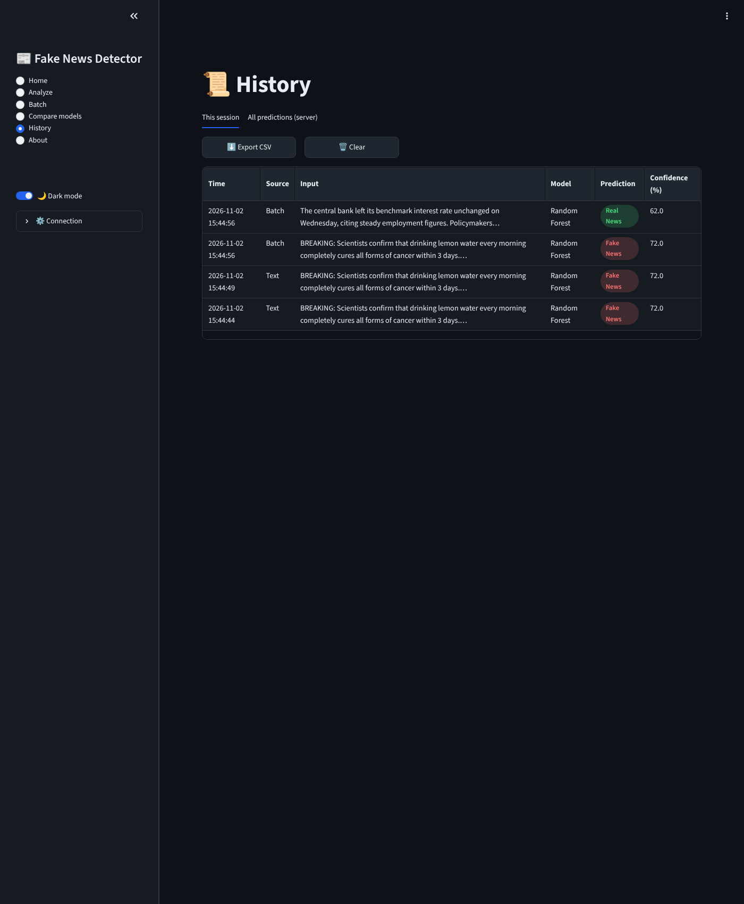
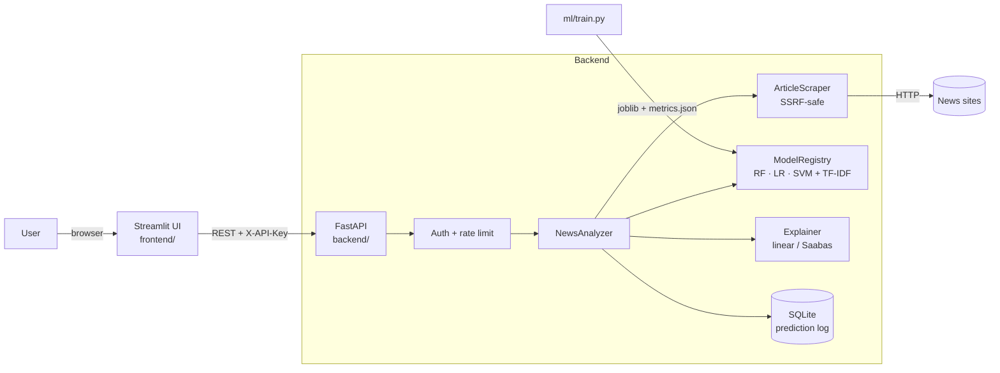

# 📰 AI-Powered Fake News Detector

[](https://github.com/Mayank-thakur21/fake-news-detector/actions/workflows/ci.yml)


Classify news articles as **Fake** or **Real** with three machine-learning models, see
**why** each prediction was made, analyse **URLs** and **whole batches**, compare models
side-by-side, and export everything to CSV. It's served by a secured FastAPI backend and a
Streamlit UI with light and dark themes.

> ⚠️ These models learn *writing style* from their training data, not facts. Treat the
> output as one signal among others: check the source and consult fact-checkers.

---

## Table of contents

- [Features](#-features)
- [Screenshots](#-screenshots)
- [Architecture](#-architecture)
- [Quick start (Docker)](#-quick-start-docker)
- [Local development](#-local-development)
- [Training the models](#-training-the-models)
- [Configuration](#%EF%B8%8F-configuration)
- [API reference](#-api-reference)
- [How explanations work](#-how-explanations-work)
- [Testing & CI](#-testing--ci)
- [Project structure](#-project-structure)
- [Security notes](#-security-notes)
- [Roadmap](#%EF%B8%8F-roadmap)

---

## ✨ Features

| | Feature | Details |
|---|---|---|
| 🔗 | **URL scraping** | Paste a news URL; the article title and body are extracted (`<article>` / `articleBody` / `<main>` heuristics, OpenGraph metadata). SSRF-safe: private, loopback and link-local addresses are blocked on every redirect hop. |
| 📚 | **Batch analysis** | Up to 25 articles per request, pasted (separated by `---`) or uploaded as a CSV with `text`/`url` columns. One bad item never fails the whole batch. |
| 🔬 | **Confidence breakdown by feature** | Per-prediction attributions: which words and phrases pushed the model toward *fake* or *real*, and what share of the evidence each one carries. |
| ⚖️ | **Model comparison** | Random Forest vs Logistic Regression vs Linear SVM: held-out accuracy, precision, recall, F1 and ROC-AUC, plus a live side-by-side verdict with majority-vote consensus. |
| 📜 | **History & CSV export** | Session history with one-click CSV export (Excel-friendly UTF-8 BOM), plus a server-side prediction log exportable via `/history/export`. |
| 🌗 | **Dark / light mode** | Per-user theme toggle; charts, tables and widgets all follow it. |
| 🔐 | **API key auth** | `X-API-Key` header, constant-time comparison, multiple keys supported. |
| ⏱️ | **Rate limiting** | Sliding-window limits per key (or IP), separate buckets for single and batch endpoints, standard `X-RateLimit-*` and `Retry-After` headers. |
| 📊 | **`/stats` endpoint** | Total predictions, last-24h volume, breakdown by label/model/source, average confidence, and every model's test accuracy. |
| 🐳 | **Production tooling** | Multi-target Dockerfile (non-root, health-checked), docker-compose, structured JSON logging with request IDs, GitHub Actions CI, 100+ pytest tests. |

---

## 📸 Screenshots

| Analyze: light | Analyze: dark |
|---|---|
|  |  |

| Home dashboard | Model comparison |
|---|---|
|  |  |

| Batch analysis | History & CSV export |
|---|---|
|  |  |

<sub>Screenshots were taken with models trained on the bundled demo sample, so the 100%
scores shown come from that tiny dataset.</sub>

---

## 🏗 Architecture



- **`ml/`** holds framework-free training, preprocessing and explainability code, shared by
  training and inference so text is always processed identically.
- **`backend/`** is a FastAPI app built by a factory (`create_app`) with lifespan-managed
  services, typed Pydantic schemas, and a consistent error envelope.
- **`frontend/`** is a Streamlit app whose logic (API client, history, parsing) lives in plain
  modules covered by unit tests.

---

## 🚀 Quick start (Docker)

```bash
git clone https://github.com/Mayank-thakur21/fake-news-detector.git
cd fake-news-detector
cp .env.example .env
```

Generate an API key, then put the same value in both `API_KEYS` and `API_KEY` in `.env`:

```bash
python -c "import secrets; print(secrets.token_urlsafe(32))"
```

```bash
docker compose up --build
```

| Service | URL |
|---|---|
| Streamlit UI | http://localhost:8501 |
| API docs (Swagger) | http://localhost:8000/docs |
| API docs (ReDoc) | http://localhost:8000/redoc |

On first start the backend trains the models automatically and stores them in a Docker
volume. To train on the **full Kaggle dataset**, place `Fake.csv` and `True.csv` in `./data/`
*before* the first start, or retrain later:

```bash
docker compose run --rm backend python -m ml.train
```

```bash
docker compose restart backend
```

---

## 💻 Local development

Requires Python 3.12+.

```bash
python -m venv .venv
```

```bash
source .venv/bin/activate
```

```bash
pip install -r requirements-dev.txt
```

```bash
cp .env.example .env
```

```bash
python -m ml.train
```

Then run the API and the UI in two terminals:

```bash
uvicorn backend.main:app --reload --port 8000
```

```bash
streamlit run frontend/streamlit_app.py
```

A `Makefile` wraps the common tasks: `make train`, `make api`, `make ui`, `make test`,
`make lint`, `make docker-up`.

---

## 🧠 Training the models

### Get the dataset

The models are designed for the
[ISOT Fake News dataset on Kaggle](https://www.kaggle.com/datasets/clmentbisaillon/fake-and-real-news-dataset)
(~44k articles). Download it and place `Fake.csv` and `True.csv` in `data/`. With the Kaggle
CLI:

```bash
kaggle datasets download -d clmentbisaillon/fake-and-real-news-dataset -p data --unzip
```

Without the dataset, training falls back to a **40-article demo sample** in `data/sample/`.
That's enough to try every feature, but **not** to make reliable predictions.

### Run training

```bash
python -m ml.train
```

Other options:

```bash
python -m ml.train --csv my_data.csv --models lr,svm
```

```bash
python -m ml.train --rf-estimators 300 --max-features 100000
```

```bash
python -m ml.train --keep-leakage
```

- `--csv` accepts any CSV with `text` (+ optional `title`) and `label` columns; labels can be
  `0`/`1`, `FAKE`/`REAL` or `true`/`false`.
- `--keep-leakage` reproduces the original notebook's inflated accuracy (see below).

Training writes `models/vectorizer.joblib`, `rf.joblib`, `lr.joblib`, `svm.joblib` and
`metrics.json` (held-out accuracy, precision, recall, F1, ROC-AUC, confusion matrix, train
time and dataset info). The API serves these numbers at `/stats` and `/models`, and the UI
shows them on the **Compare models** page.

### Pipeline

1. **Cleaning:** lowercase; strip URLs, HTML, `[bracketed]` text and digit-words; collapse
   whitespace.
2. **Leakage removal:** almost every *real* article in ISOT begins with a
   `CITY (Reuters) -` dateline. A model can score ~99% just by spotting the word "reuters",
   which says nothing about whether an article is true. Datelines and the token `reuters` are
   stripped by default, so the reported accuracy reflects the content.
3. **De-duplication:** exact duplicates are removed *before* the train/test split so they
   can't leak across it.
4. **Features:** TF-IDF with unigrams and bigrams, English stop-words removed, sublinear TF,
   and up to 50k features.
5. **Models:**
   - Random Forest with 200 trees and balanced class weights
   - Logistic Regression with C=4 and balanced class weights
   - Linear SVM, wrapped in `CalibratedClassifierCV` to give real probabilities
6. **Evaluation:** a stratified 80/20 split, with the fake class treated as positive.

> The original notebook reported **99.65%** accuracy for Random Forest on ISOT *with* the
> dateline leakage. Expect lower, but more honest, numbers from the default pipeline. Your
> exact figures are in `models/metrics.json` after training.

---

## ⚙️ Configuration

All settings come from environment variables (or `.env`). See [`.env.example`](.env.example).

| Variable | Default | Description |
|---|---|---|
| `API_KEYS` | *(empty)* | Comma-separated valid keys. **Empty disables auth** (a warning is logged). |
| `RATE_LIMIT_PER_MINUTE` | `60` | Limit for `/predict`, `/compare` and `/scrape`, per key or IP |
| `BATCH_RATE_LIMIT_PER_MINUTE` | `10` | Limit for `/predict/batch` |
| `BATCH_MAX_ITEMS` | `25` | Maximum articles per batch |
| `DEFAULT_MODEL` | `rf` | `rf`, `lr` or `svm`. Falls back to the best available model if missing. |
| `MODEL_DIR` | `models` | Where the training artifacts live |
| `DB_PATH` | `storage/predictions.db` | SQLite prediction log |
| `MIN_WORDS` / `MAX_TEXT_CHARS` | `5` / `100000` | Input validation |
| `SCRAPER_TIMEOUT` / `SCRAPER_MAX_BYTES` | `10` / `5000000` | URL fetch limits |
| `SCRAPER_ALLOW_PRIVATE_HOSTS` | `false` | Keep `false` in production (SSRF protection) |
| `CORS_ORIGINS` | `*` | Allowed browser origins |
| `LOG_LEVEL` / `LOG_JSON` | `INFO` / `false` | Use `LOG_JSON=true` for one-JSON-object-per-line logs |
| `AUTO_TRAIN` | `true` | Docker: train on start if no models exist |
| `API_URL` / `API_KEY` | `http://127.0.0.1:8000` / *(empty)* | Frontend → backend connection |
| `DEFAULT_THEME` | `light` | Initial UI theme |

---

## 📡 API reference

Interactive docs live at **`/docs`**. Every endpoint except `/` and `/health` requires
`X-API-Key` when `API_KEYS` is set.

| Method | Path | Description |
|---|---|---|
| `GET` | `/` | API info |
| `GET` | `/health` | Liveness and readiness: `ok` or `degraded` (models missing) |
| `POST` | `/predict` | Classify one article (`text` **or** `url`) |
| `POST` | `/predict/batch` | Classify up to `BATCH_MAX_ITEMS` articles |
| `POST` | `/compare` | Run every model on one article |
| `POST` | `/scrape` | Extract an article from a URL without predicting |
| `GET` | `/models` | Loaded models with their test metrics |
| `GET` | `/stats` | Accuracy, prediction counters and uptime |
| `GET` | `/history?limit=50` | Recent predictions (JSON) |
| `GET` | `/history/export` | Prediction log as a CSV download |
| `POST` | `/admin/reload` | Reload model files from disk after retraining |

### `POST /predict`

```bash
curl -X POST http://localhost:8000/predict \
  -H "Content-Type: application/json" -H "X-API-Key: $API_KEY" \
  -d '{"text": "BREAKING: Secret study proves lemon water cures cancer...", "model": "lr", "top_k": 3}'
```

The request body takes exactly one of `text` or `url`. `news` is accepted as an alias for
`text`, for v1 compatibility. The other fields are `model` (`rf`, `lr` or `svm`), `explain`
(default `true`) and `top_k` (1–30).

```json
{
  "prediction": "Fake News",
  "is_fake": true,
  "confidence": 93.12,
  "probabilities": { "fake": 0.9312, "real": 0.0688 },
  "model": "lr",
  "model_name": "Logistic Regression",
  "explanation": {
    "method": "linear (tfidf x coefficient)",
    "base_value": null,
    "toward_fake": [
      { "term": "secret", "weight": -0.0925, "share": 13.85, "tfidf": 0.31, "present": true },
      { "term": "breaking", "weight": -0.0772, "share": 11.56, "tfidf": 0.27, "present": true }
    ],
    "toward_real": [
      { "term": "study", "weight": 0.0607, "share": 9.09, "tfidf": 0.22, "present": true }
    ]
  },
  "source": { "type": "text", "word_count": 12, "url": null, "final_url": null, "title": null, "site_name": null, "published_at": null },
  "processing_ms": 4.2,
  "prediction_id": 17
}
```

To classify a URL instead, send `url` in place of `text`:

```bash
curl -X POST http://localhost:8000/predict -H "Content-Type: application/json" -H "X-API-Key: $API_KEY" \
  -d '{"url": "https://www.example.com/news/some-story"}'
```

### `POST /predict/batch`

```json
{ "items": [ { "id": "a1", "text": "..." }, { "url": "https://..." } ], "model": "svm" }
```

The response has one entry per item, either `{ index, id, ok: true, result }` or
`{ index, id, ok: false, error }`, plus a summary:
`{ total, succeeded, failed, fake, real, average_confidence }`.

### `POST /compare`

```json
{ "text": "...", "explain": true, "top_k": 5 }
```

Returns each model's verdict, probabilities and test accuracy and F1, plus `consensus`
(majority vote, with ties broken by mean probability), `agreement` (% of models agreeing)
and `mean_fake_probability`.

### `GET /stats`

```json
{
  "total_predictions": 1284,
  "last_24h": 97,
  "average_confidence": 87.4,
  "by_label": { "Fake News": 702, "Real News": 582 },
  "by_model": { "rf": 1100, "lr": 120, "svm": 40, "ensemble": 24 },
  "by_source": { "text": 900, "url": 300, "batch": 60, "compare:text": 24 },
  "model_accuracy": { "rf": 0.97, "lr": 0.98, "svm": 0.985 },
  "models": { "default_model": "rf", "best_model": "svm", "trained_at": "...", "dataset": { "...": "..." } },
  "uptime_seconds": 3600.2,
  "version": "2.0.0"
}
```

### Errors

Every error uses the same envelope:

```json
{ "error": { "code": "rate_limited", "message": "Rate limit exceeded: 60 requests/minute for 'predict'", "request_id": "a1b2c3d4e5f6" } }
```

| Status | `code` | When |
|---|---|---|
| 401 | `unauthorized` | Missing or invalid API key |
| 404 | `unknown_model` | A valid model key whose model isn't loaded |
| 422 | `validation_error` / `invalid_input` / `scrape_failed` | Bad payload, text too short, or page not extractable or blocked |
| 429 | `rate_limited` | Too many requests (see `Retry-After`) |
| 502 | `upstream_error` | The news site timed out or returned 5xx |
| 503 | `model_not_ready` | No trained models are loaded |

Every response carries an `X-Request-ID` header that matches the server log lines for that
request.

---

## 🔬 How explanations work

The **confidence breakdown** attributes the prediction to individual vocabulary terms.
Contributions are signed: **negative pushes toward fake, positive toward real**. `share` is
each term's percentage of the total absolute evidence.

- **Logistic Regression and Linear SVM:** `contribution = tfidf(term) × coefficient(term)`.
  This is exact for the model's decision function.
- **Random Forest:** a *Saabas decision-path decomposition*. As each tree routes the document
  from root to leaf, every split changes the predicted probability, and that change is
  credited to the split's term. Averaged over all trees, it satisfies
  `prior + Σ contributions = predicted probability` exactly (this is unit-tested). Trees can
  also split on a term being *absent*; the UI labels those terms "(absent)".

---

## 🧪 Testing & CI

```bash
pytest --cov
```

```bash
ruff check .
```

```bash
ruff format --check .
```

The suite has 100+ tests covering:

- preprocessing and leakage removal
- the training pipeline and CLI
- explanation maths, including exact RF decomposition
- the scraper: extraction, redirects, SSRF blocking, size and timeout limits
- the rate limiter and the SQLite store
- every API endpoint: auth, validation, 429 and 503 paths
- the frontend's API client, history, CSV and batch-parsing helpers

Tests train tiny models on a synthetic corpus, so they need no dataset and run in seconds.

**GitHub Actions** (`.github/workflows/ci.yml`) runs on every push and PR:
1. **Lint:** `ruff check` and `ruff format --check`
2. **Test:** pytest with coverage on Python 3.12 and 3.13, plus a training smoke test
3. **Docker:** builds both image targets

---

## 📁 Project structure

```
fake-news-detector/
├── backend/                     # FastAPI service
│   ├── main.py                  # App factory, middleware, lifespan
│   ├── schemas.py               # Pydantic request/response models
│   ├── api/
│   │   ├── routes.py            # All HTTP endpoints
│   │   └── deps.py              # Dependency providers
│   ├── core/
│   │   ├── config.py            # Settings (env / .env)
│   │   ├── security.py          # X-API-Key auth
│   │   ├── rate_limit.py        # Sliding-window limiter
│   │   ├── errors.py            # Domain errors → HTTP envelope
│   │   └── logging.py           # Text/JSON logging with request IDs
│   └── services/
│       ├── analyzer.py          # Predict / compare orchestration
│       ├── model_registry.py    # Loads models + metrics
│       ├── scraper.py           # SSRF-safe article extraction
│       └── prediction_store.py  # SQLite log for /stats & /history
├── ml/
│   ├── preprocessing.py         # Shared text cleaning
│   ├── train.py                 # Training CLI (RF / LR / SVM)
│   └── explain.py               # Feature attributions
├── frontend/
│   ├── streamlit_app.py         # Pages & layout
│   ├── components.py            # Charts, cards, themed tables
│   ├── api_client.py            # Typed HTTP client
│   ├── history.py               # History / CSV / batch parsing
│   └── theme.py                 # Light & dark palettes
├── tests/                       # pytest suite
├── data/sample/                 # 40-article demo dataset
├── models/                      # Training output (git-ignored)
├── storage/                     # SQLite DB (git-ignored)
├── notebooks/                   # Original exploration notebook
├── docs/                        # Screenshots, presentation, demo articles
├── scripts/docker-entrypoint.sh
├── Dockerfile                   # Targets: backend, frontend
├── docker-compose.yml
├── requirements.txt             # → requirements/{backend,frontend}.txt
├── requirements-dev.txt
├── pyproject.toml               # ruff + pytest config
├── Makefile
└── .env.example
```

Sample articles for manual testing are in [`docs/demo_news.md`](docs/demo_news.md).

---

## 🔒 Security notes

- **Auth:** always set `API_KEYS` outside local development. Keys are compared in constant
  time, and only a SHA-256 fingerprint is stored with predictions.
- **SSRF:** the scraper resolves every hostname, including after each redirect, and refuses
  non-public IPs such as `127.0.0.1`, `10.0.0.0/8` and `169.254.169.254`. Response size,
  content type and timeouts are capped.
- **Rate limits** are per process. If you run several replicas behind a load balancer, back
  `SlidingWindowLimiter` with Redis (same interface).
- **Containers** run as a non-root user and have health checks.

---

## 🗺️ Roadmap

- Transformer model (DistilBERT / RoBERTa) as a fourth comparable model
- Source credibility scoring (domain reputation)
- Multi-language support
- Browser extension calling `/predict`
- Redis-backed rate limiting and Postgres history for multi-instance deployments
